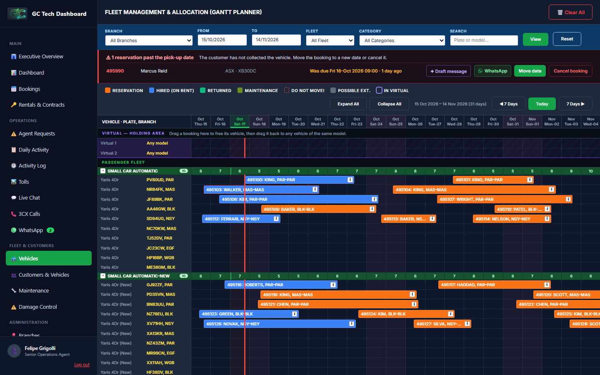

# GC Tech Rentals — Car & Truck Rental Platform

A working prototype of a complete rental platform: a public booking website, a customer portal and the staff operations system (RCM) that runs the counter — all sharing one set of data.

**▶ Live demo: https://felipegrigolli.github.io/gc-tech/**

> GC Tech Rentals is a fictional company, and all prices, branches, people and vehicle illustrations are made up for this project. The project started from real problems I saw working at a car & truck rental counter, so the workflows and business rules are the ones a real team deals with every day.



## What it does

| Area | Highlights |
|---|---|
| **Website & checkout** | Search by branch and dates, live availability per category, excess options, extras, a 3-step checkout. When a category is fully booked the customer can still send a request and pick a back-up vehicle. |
| **Customer portal** | Upcoming and past hires, change pick-up time, accept alternative offers, payment plans, a "bond on hold" card with a refund request by live chat, WhatsApp or email. |
| **Fleet Planner** | Gantt timeline of the whole fleet: drag & drop between vehicles, a virtual holding area for swaps, possible extensions, weekend holds, maintenance blocks. |
| **Booking details** | RCM-style booking window: driver details, fees, payments ledger, documents, notes, chat and a full activity log per booking. |
| **Operations** | Today's overview, daily pick-up/return report, agent requests (bookings with no vehicle), bond refunds queue, damage reports, tolls, payment plans, live chat and a WhatsApp inbox. |

## Business rules implemented

- **No double bookings:** a vehicle can't be booked twice, and every booking keeps a **15-minute turnaround** from the next one.
- **Opening hours:** pick-ups and returns only between 08:00 and 17:15, in 15-minute slots.
- **Minimum age 21** for every driver on the pick-up date.
- **Kilometre allowance for commercial vehicles** (trucks, vans, utes), calculated from the odometer readings at pick-up and return. The return reading carries over to the next booking of the same vehicle.
- **Early or late returns:** returning a vehicle uses today's date; unused days are refunded together with the bond, extra days are charged.
- **Bond refunds:** every refund that differs from the bond explains why (extra kms, damage, early return…). A bond can be held with a mandatory reason, e.g. kept for the customer's next hire.
- **One agent per conversation:** live chat and WhatsApp threads are locked to the agent handling them; others can take over with a confirmation.

## Try it

Open the [live demo](https://felipegrigolli.github.io/gc-tech/) and use the sign-in details on the cover page:

| Login | Username / email | Password |
|---|---|---|
| Staff (RCM) | `felipe` | `gctech` |
| Customer portal | `felipe@testgctech.com` | `password123` |

Data is saved in your browser (`localStorage`). **Reset demo data** on the cover page restores the sample bookings.

To run it locally, open `web/index.html`, or on Windows run `web/Start GC Tech Demo.bat` (a tiny local server, so several windows stay in sync).

## How it's built

Today the prototype is plain **HTML, CSS and JavaScript** — no framework and no backend. All data and rules live in the browser:

| File | Role |
|---|---|
| `web/js/gc-fleet-data.js` | Fleet, branches, sample bookings and the shared rules (availability, turnaround, ages, odometer) |
| `web/js/gc-fees-data.js` | Fees catalogue, excess options, kilometre allowance and the booking statement maths |
| `web/js/gc-bonds.js` | Bond refunds, bond on hold and the refund breakdown |
| `web/js/rcm-fleet-planner.js` | The Fleet Planner and the booking window |

## Roadmap: a real REST API

The next step is moving the rules from the browser to a server. I'm building a **Node.js + Express + SQLite** API one endpoint at a time, with notes on what each step teaches in [`docs/learning`](docs/learning/README.md).

- [ ] `GET /health`
- [ ] `GET /vehicles`, `GET /vehicles/:plate`
- [ ] `GET /availability` (with the 15-minute turnaround)
- [ ] `POST /bookings` (opening hours, minimum age, overlaps)
- [ ] `PATCH /bookings/:id/return` (kilometres, unused days, refund)
- [ ] `/bonds` hold and refund
- [ ] Authentication, automated tests and OpenAPI docs

## Repository layout

```
web/    the prototype (published with GitHub Pages)
api/    the REST API (in progress)
docs/   architecture and learning notes
```

---

Built by **Felipe Grigolli**.
